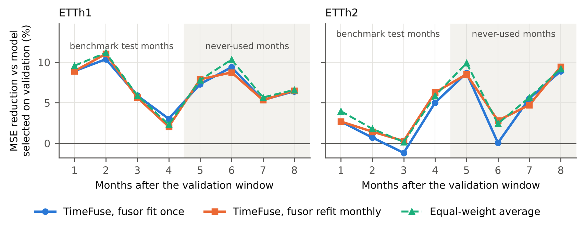

# Does Sample-Level Model Fusion Age Well? A Deployment-Faithful Evaluation of TimeFuse

**Paper (PDF):** [Khan_2026_Does_Sample-Level_Model_Fusion_Age_Well.pdf](Khan_2026_Does_Sample-Level_Model_Fusion_Age_Well.pdf)

Re-evaluates [TimeFuse](https://github.com/ZhiningLiu1998/TimeFuse) (Liu et al., ICML 2025) on ETTh1/ETTh2 with its released code and default six-model configuration, under three deployment-faithful protocols:

- **A+**: evaluation on months 21-24, which the standard ETT split never uses
- **B**: monthly refitting of the fusor on the latest four months
- **C**: fusors fitted on windows 0-4 months stale

## Key results (MSE, horizon 96)

| | TimeFuse (ours) | TimeFuse (paper) | vs validation-selected model | vs equal-weight average |
|---|---|---|---|---|
| ETTh1 test | 0.368 | 0.367 | 7.1% better (p < .001) | 0.2% worse (p = .18) |
| ETTh2 test | 0.282 | 0.280 | 1.7% better (p = .47) | 1.1% worse (p = .008) |

- A fusor up to four months stale loses at most 0.74% MSE; monthly refitting is never significantly better.
- On ETTh1 the best single model changes every month (five different architectures), so fusion mainly insures against model-selection error.
- With six competitive models, learned weights stay near uniform and an equal-weight average matches TimeFuse.

## Reproduce

Open `TimeFuse_deployment_study.ipynb` in Colab with a T4 GPU and run all (about 40 minutes). Scripts in `scripts/` run in order: `train_base.py`, `meta_full.py`, `infer_full.py`, `analysis.py`, `figs.py`. Statistics: Diebold-Mariano with HLN correction (Newey-West lag 95) and a moving-block bootstrap (one-week blocks, 2,000 resamples).

Author: Muhammad Imad Khan, GIKI.
